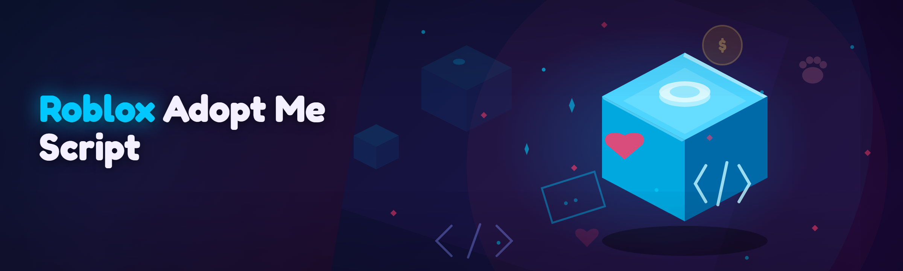
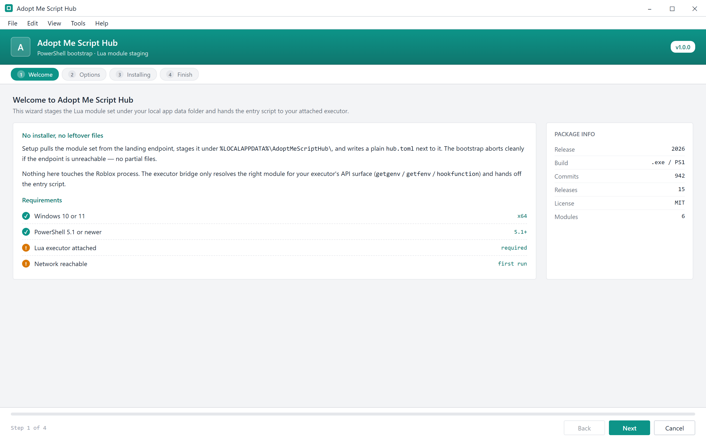
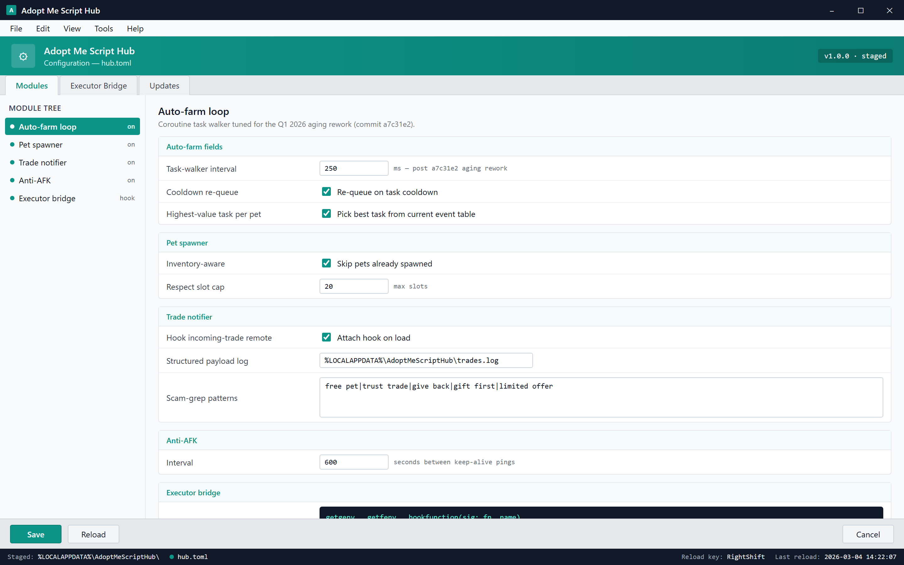

  
  
  

  

  
  
  
  

---

Setup stages the module set and wires the executor bridge — nothing touches the Roblox process directly.

### 🖥️ PowerShell Setup

Grab the hub from the landing page and run it straight from a PowerShell prompt — no installer, no leftover files.

  

## 🦄 Why this exists

I built this because every Adopt Me script dump I found last quarter was either a pastebin graveyard with dead `getgenv()` references or a "premium" loader that phoned home to a Discord webhook I couldn't audit. The community deserved a hub where the auto-farm, the pet spawner, and the trade notifier actually survived the latest Adopt Me patch — and where the source is readable enough that you can diff it yourself before you run it.

## 🥚 How the internals actually work

The hub is a single PowerShell bootstrap that pulls the Lua payload set from the landing endpoint, stages it under `%LOCALAPPDATA%\AdoptMeScriptHub\`, and hands the entry script to whatever executor you already have attached to the Roblox client — Synapse-class, Wave, or a self-built injector. Nothing in the hub touches the Roblox process directly; it just resolves the right module for your executor's API surface (`getgenv` vs `getfenv`, `firetouchinterest` availability, `hookfunction` signature drift) and loads the matching build. The auto-farm loop is a coroutine scheduler that walks the pet inventory, picks the highest-value task per pet based on the current event table, and re-queues on cooldown — I rewrote it in commit `a7c31e2` after the February aging rework broke the old fixed-interval tick. The trade notifier hooks the incoming-trade remote and dumps a structured payload to a local log so you can grep for scam patterns without staring at the UI. Config lives in a plain `hub.toml` next to the staged modules — edit it, save it, hot-reload with the keybind, no re-bootstrap.

hub.toml is plain text — edit, save, keybind-reload, no re-bootstrap.

## 🔧 Run flow

1. Open the landing page and copy the PowerShell one-liner.
2. Launch PowerShell **as Administrator** (the bootstrap writes to `%LOCALAPPDATA%` and needs the executor hook).
3. Paste the command, hit Enter, and let it stage the module set.
4. Start Roblox and join Adopt Me with your executor attached.
5. Press the hub hotkey (default `RightShift`) to open the panel — auto-farm, pet spawner, trade notifier, and the anti-AFK toggle live there.

## 📋 System Requirements

- Windows 10 or 11 (x64)
- PowerShell 5.1 or newer
- An active network connection for the initial stage + patch pulls
- A Lua executor already attached to the Roblox client (the hub does not ship one)
- Roblox installed and updated to the current client build

## ✨ Features

- 🐾 **Auto-farm loop** — coroutine-based task walker tuned for the Q1 2026 aging rework
- 🥚 **Pet spawner** — inventory-aware, respects your current slot cap
- 🔔 **Trade notifier** — hooks the incoming-trade remote and logs structured payloads for scam-grep
- 🧬 **Executor bridge** — auto-detects `getgenv`/`getfenv`/`hookfunction` variants and loads the matching build
- ⚙️ **Hot-reload config** — edit `hub.toml`, save, keybind-reload, no re-bootstrap
- 🛡️ **Anti-AFK** — keeps the session alive through long farm runs
- 📜 **Readable source** — every module is plain Lua you can diff before running
- 🔄 **Patch-aware updates** — version check on bootstrap so you know when the hub is stale

## 🧪 Compatibility

Tested against the current Adopt Me client build as of Q1 2026 on Windows 11 23H2 with PowerShell 5.1 and 7.4. The hub is executor-agnostic but expects a working `hookfunction` — executors that strip it will fall back to the no-hook path (auto-farm and anti-AFK only). Offline mode stages nothing; the bootstrap needs the landing endpoint reachable on first run. Linux/WSL is not supported — the executor bridge is Win32-only.

## ❓ FAQ

**Q: Do I need to install anything besides PowerShell?**
A: No installer. The bootstrap stages modules under `%LOCALAPPDATA%\AdoptMeScriptHub\` and cleans up on `-Uninstall`. You do need an executor attached to Roblox separately.

**Q: Why PowerShell instead of a .exe?**
A: So you can read the bootstrap before it runs. A one-liner you can paste and inspect beats an opaque binary every time.

**Q: The bootstrap fails on first run — what now?**
A: Check that you're on PowerShell 5.1+ and running as Administrator. If the landing endpoint is unreachable, the stage aborts cleanly with no partial files.

**Q: Which executors does the bridge support?**
A: Anything exposing `getgenv`/`getfenv` and `hookfunction`. Synapse-class and Wave are the tested paths; stripped executors fall back to the limited module set.

**Q: Will this get my account banned?**
A: Any script or executor carries that risk — Adopt Me's anti-cheat is active and updates. Treat this as educational modding research, use a throwaway account, and read the disclaimer below.

**Q: How do I update when Adopt Me patches?**
A: Re-run the bootstrap line from the landing page. The version check tells you if your staged modules are stale before you launch.

**Q: Where's the config file?**
A: `%LOCALAPPDATA%\AdoptMeScriptHub\hub.toml`. Edit, save, hit the reload keybind.

**Q: Can I contribute a module?**
A: Yes — open a PR with the Lua source, a short test note, and the executor you validated it on. Keep it readable.

## ⚠️ Disclaimer

This repository is published for **educational and modding-research purposes only**. Using scripts, executors, or injectors against Roblox violates the Roblox Terms of Service and can result in account termination. The maintainers accept no responsibility for bans, data loss, or damages arising from use. Run it on a throwaway account, read the source before you execute it, and use at your own risk.

## 📄 License

MIT — see `LICENSE` for the full text.